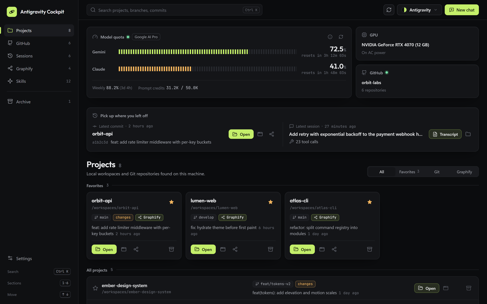
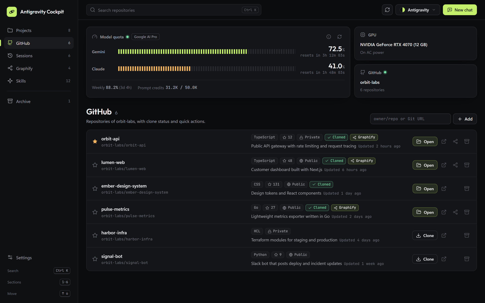
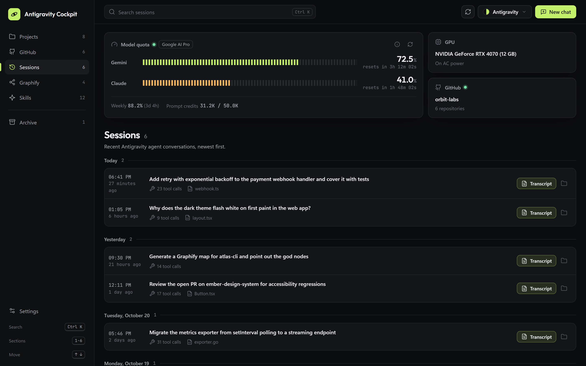
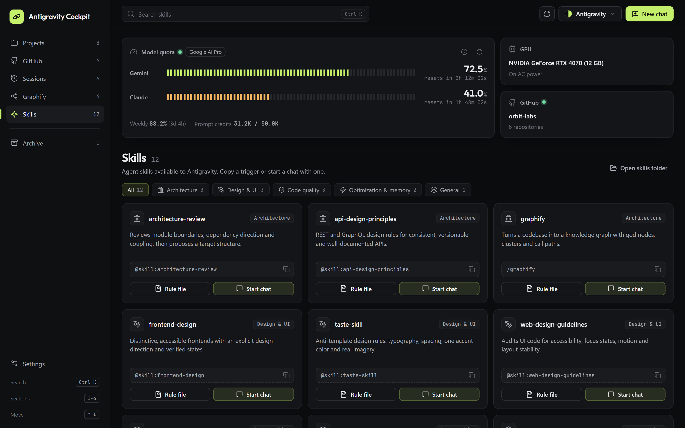
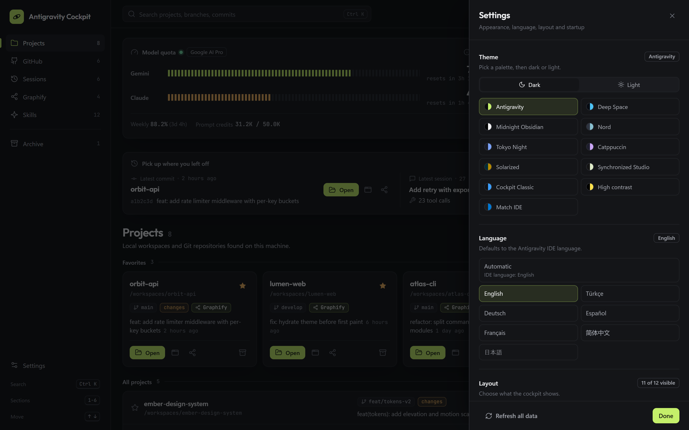
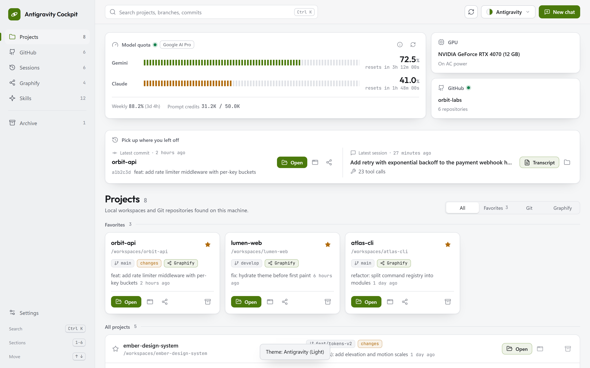
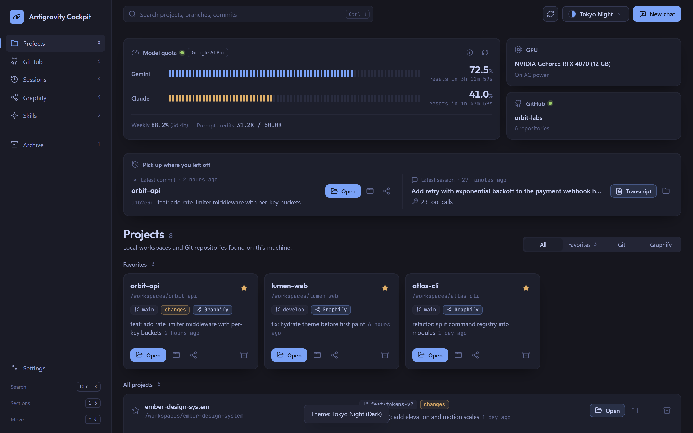
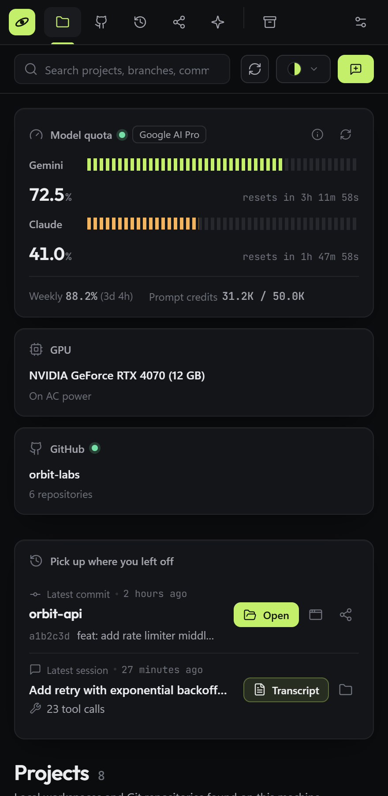

# 🚀 Antigravity Cockpit

> **Universal AI Engineering Cockpit for Google Antigravity**  
> Turn any fresh Antigravity installation into an elite, token-optimized, high-performance pair programming environment with a futuristic startup dashboard in seconds.

[](https://opensource.org/licenses/MIT)
[](#)
[](#1-%EF%B8%8F-antigravity-activity-dashboard--cockpit-startup-panel)
[](#5-%EF%B8%8F-50-curated-skills)
[](#2--zero-waste--persistent-project-memory)


---

## ⚡ Quick Start

### Method 1: From Antigravity Chat (Recommended)
Clone the repository to your local machine or open it as a workspace, then type this into the Antigravity chat:

> **"Adopt this repository"** (the Turkish trigger **"Bu depoyu benimse"** works too)

Antigravity will install the rules, 50+ skills, plugins, and the **Cockpit Dashboard that starts automatically on launch** directly on your system.

---

### Method 2: One-Click Setup from the Terminal

#### 🪟 Windows (PowerShell):
```powershell
git clone https://github.com/HasanKaan28/antigravity-cockpit.git
cd antigravity-cockpit
powershell -ExecutionPolicy Bypass -File .\scripts\adopt.ps1
```

#### 🐧 Linux / macOS / WSL (Bash):
```bash
git clone https://github.com/HasanKaan28/antigravity-cockpit.git
cd antigravity-cockpit
bash ./scripts/adopt.sh
```

*(Optional)* To install the recommended IDE extensions:
```powershell
powershell -ExecutionPolicy Bypass -File .\scripts\install_extensions.ps1
```

---

## 🌟 Core Features

### 1. 🎛️ Antigravity Activity Dashboard & Cockpit (Startup Panel)
A mission-control panel that greets you every time Antigravity IDE opens:
- **Live model quota:** Tick-meter gauges for Gemini and Claude with live reset countdowns, weekly quota and prompt credits.
- **Pick up where you left off:** Your latest commit and latest agent session, one click away from reopening.
- **Projects, GitHub, Sessions, Graphify and Skills:** Local workspaces with Git status, your repositories with clone status, day-grouped agent sessions with a transcript viewer, Graphify maps, and your agent skills with one-click triggers.
- **Made to fit your IDE:** 10 palettes in dark and light plus **Match IDE**, 7 interface languages, keyboard navigation, a layout that works in a narrow side panel, and optional interface sounds.

| Projects | GitHub |
|---|---|
|  |  |
| **Sessions** | **Skills** |
|  |  |
| **Settings** | **Light theme** |
|  |  |
| **Tokyo Night** | **Narrow side panel** |
|  |  |

The screenshots and the demo use fictional sample data. Regenerate them with `npm run docs:capture` in `extensions/antigravity-activity-dashboard`.

---

### 2. 🧠 Zero Waste & Persistent Project Memory
- Cuts the token cost of re-reading huge codebases end to end on every turn down to zero.
- Automatically keeps and updates `.agents/rules/project-context.md` and compact architecture snapshots in every project.

---

### 3. 👑 Cyberpunk Graphify Observatory
- Scans the function and module relationships of your codebase in the background and produces a live knowledge graph (`graph.html`) in the **Deep Space / Cyberpunk Observatory UI**.
- Includes a live HUD panel, "God Nodes" highlighting, physics freeze, a Ctrl+K search engine, and Web Audio sound effects.

---

### 4. 🎨 Anti-Slop & Premium Web Design Standard
- Bans the soulless gray card templates that are an AI cliché.
- Enforces Google Fonts (Inter, Plus Jakarta Sans, Outfit), modern glassmorphism, custom color palettes, and micro-animation standards.

---

### 5. 🛠️ 50+ Curated Skills
- **Software Architecture & Clean Code:** `clean-code`, `architecture-review`, `api-design-principles`, `debugging-toolkit`, `agent-qa-debug-fix`.
- **Modern Frontend:** `taste-skill`, `awesome-design`, `frontend-design`, `image-to-code`, `web-design-guidelines`.
- **E2E & Testing:** `playwright-cli`, `playwright-component-testing`, `playwright-trace`.
- **Data & Cloud Engineering:** `bigquery-*`, `gcp-*`, `dbt-bigquery`, `dataform-bigquery`, `notebook-guidance`, `schema-mapping`.
- **Mapping & Memory:** `graphify`, `project-persistent-memory`, `codebase-memory`.

---

### 6. 📋 Antigravity Clipboard Bridge (`abc`)
- A multi-agent bridge that keeps clipboards in seamless sync between agents and the host operating system.

---

## 📂 Directory Structure

```text
antigravity-cockpit/
├── GEMINI.md                               # Universal global rules
├── README.md                               # Setup and usage guide
├── LICENSE                                 # MIT License
├── .gitignore                              # Strict security and privacy filter
├── config/
│   ├── mcp_config.example.json             # Example Model Context Protocol configuration
│   ├── plugins/                            # Antigravity plugins (Clipboard Bridge)
│   └── skills/                             # 50+ curated skills
├── extensions/
│   ├── antigravity-activity-dashboard/     # Futuristic startup control panel extension (source code)
│   └── antigravity-activity-dashboard-2.3.0.vsix # One-click installable package
└── scripts/
    ├── adopt.ps1                           # Windows one-click setup (Dashboard included)
    ├── adopt.sh                            # Linux/macOS one-click setup (Dashboard included)
    └── install_extensions.ps1              # IDE extensions and VSIX installer
```

---

## 🤝 Contributing

Feel free to open a Pull Request to add new skills, improved rules, or optimizations!

1. Fork this repository.
2. Create your feature branch (`git checkout -b feature/amazing-skill`).
3. Commit your changes (`git commit -m 'feat: add amazing skill'`).
4. Push to your branch (`git push origin feature/amazing-skill`).
5. Open a Pull Request.

---

## 📄 License

This project is licensed under the **MIT License**. See the [LICENSE](LICENSE) file for details.
