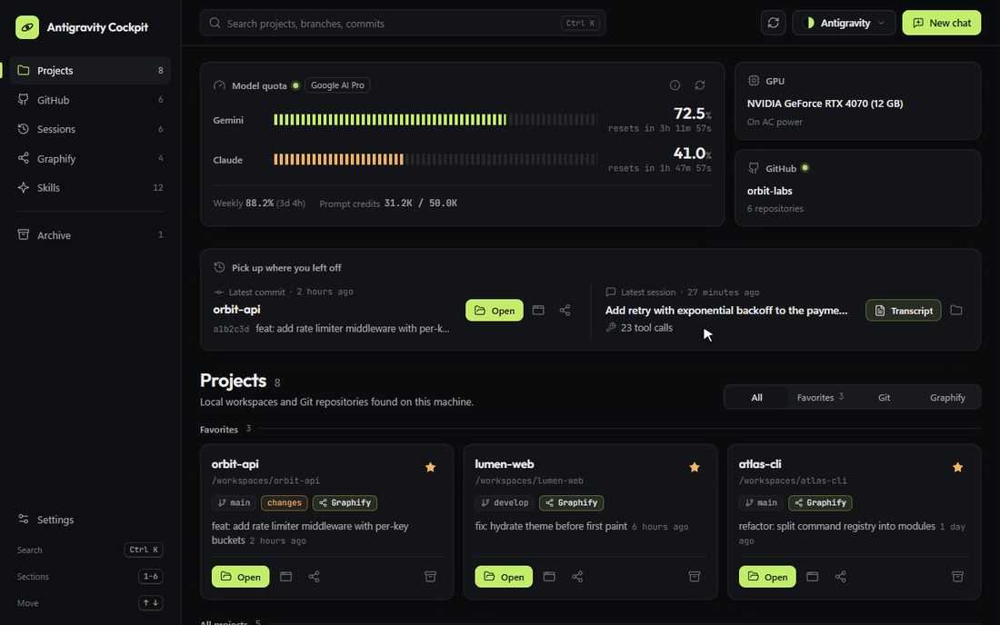

# ⚡ Antigravity Cockpit & Activity Dashboard

[](LICENSE)
[](package.json)
[](package.json)
[](#-dynamic-agent-skills-detection)

> **Futuristic Deep Space Mission Control Dashboard and Agent Workspace Cockpit for Antigravity IDE.**

Antigravity Cockpit greets you **automatically on every Antigravity IDE launch**, unifying your workspace projects, GitHub repositories, recent chat sessions, Graphify knowledge graphs, and live AI model quotas into a single mission-control screen.



More screenshots (every section, light mode, other palettes and the narrow side panel) are in the [repository README](../../README.md#1-%EF%B8%8F-antigravity-activity-dashboard--cockpit-startup-panel).

---

## 🚀 Zero-Touch Automated Setup

Installing this repository is completely automated for developers and AI agents:

### Option 1: One-Prompt AI Agent Install (Recommended)
Tell your Antigravity agent:
> *"Install and setup Antigravity Cockpit dashboard"*

The AI agent reads [`AGENTS.md`](AGENTS.md) / [`GEMINI.md`](GEMINI.md) and executes the automated setup protocol, installing the extension and configuring auto-launch in seconds.

---

### Option 2: One-Click Installer Scripts

* **Windows (Fastest):**  
  Double-click **[`setup.bat`](setup.bat)**  
  *(or via PowerShell: `powershell -ExecutionPolicy Bypass -File .\setup.ps1`)*

* **macOS / Linux:**  
  Run **`./setup.sh`**

* **Node.js / Terminal:**  
  ```bash
  npm install
  npm run setup
  ```

### What Happens Automatically:
1. ⚡ **Cockpit Extension Installed:** The `.vsix` package is installed directly into Antigravity IDE and configured to **auto-launch on IDE startup**.
2. ⚡ **Status Bar Item Active:** Permanent `$(dashboard) Cockpit` quick-launch toggle pinned to your status bar.
3. 🧠 **Dynamic Skills Auto-Detection:** Automatically scans and organizes your own local agent skills from `~/.gemini/config/skills/`, IDE builtin skills, and workspace `.agents/skills`.
4. 🖥️ **Hardware Telemetry:** Dynamically probes your system GPU (NVIDIA, AMD, Intel, Apple Silicon) and power state without hardcoded device IDs.

---

## ✨ Key Features

### 🌌 Deep Space Mission Control
- **Auto-Launch on Startup:** Opens ~1.2 seconds after IDE launch (`openOnStartup: true`).
- **Webview Serializer:** Seamlessly restores your open dashboard tab and state across IDE restarts.
- **Mission Control Layout:** Left section rail with live counts, a shared `Ctrl+K` search bar, tick-meter quota instruments with live reset countdowns, and a settings sheet. Fully keyboard accessible, responsive down to narrow side panels, and respects `prefers-reduced-motion`.
- **Full Theme Suite:** Antigravity, Deep Space, Midnight Obsidian, Nord, Tokyo Night, Catppuccin, Solarized, Synchronized Studio, Cockpit Classic and High Contrast, each in Dark and Light, plus **Match IDE** which follows the active IDE color theme. Every palette is checked for WCAG contrast by the E2E audit.
- **Optional extras:** Web Audio interface sounds and a particle background, both toggleable in Settings.

### 📁 Workspace & Project Explorer
- Real-time detection across active workspaces, recent projects, standard development folders (`~/Projects`, `~/dev`, `~/code`, `~/github-repos`), and expanded project signatures.
- Git branch name, latest commit date, and uncommitted diff indicators.
- Live **Graphify** visual graph indicators.
- Pin favorites and archive finished repositories with instant search filtering.
- **Zero-State Support:** Direct "Open folder" action when no workspaces are detected.

### 🐙 GitHub Integration
- Direct integration via official `gh` CLI with zero credentials storage.
- One-click repository cloning directly into your local repositories folder.
- Dynamic detection of the active GitHub user with a clean **"Connect GitHub"** (`gh auth login`) onboarding prompt when unauthenticated.
- Add external custom repositories by `owner/repo` to monitor commits and stars.

### 🧠 Dynamic Agent Skills Detection
- Automatically detects and categorizes all skills installed on your machine (`~/.gemini/config/skills/`, builtin, and workspace).
- Categorized into Architecture, Design & UI, Code Quality, Optimization, and Local AI.
- **One-Click Prompt Triggering:** Copy instant trigger prompts (e.g. `/graphify`, `@skill:clean-code`) with a single click.
- **Rule Inspection & Quick Chat:** Open `SKILL.md` rules directly in editor or launch a dedicated AI chat configured with the skill.
- **Zero Fallback Counts:** Never displays artificial fallback numbers; accurately displays 0 or actual installed skills.

### 💬 Chat Sessions & Dialogue Transcript Viewer
- Reads recent Antigravity brain sessions from `~/.gemini/antigravity-ide/brain`.
- Built-in distraction-free **Dialogue Transcript Viewer** stripping system metadata to show pure conversation flow, with copyable markdown and search.

### 📊 Live Model Quotas & Telemetry
- Real-time Gemini and Claude quota percentages (from Antigravity Panel SQLite).
- Silent background watcher alerting you when significant quota shifts occur.
- Hardware telemetry: Dynamic GPU detection (WMI, macOS system profiler, Linux lspci, nvidia-smi) and power status (AC vs battery).

---

## 🛠️ Development Scripts

| Command | Description |
|---|---|
| `npm run setup` | Runs the automated VSIX installer (`scripts/setup.js`) |
| `npm run package` | Packages `antigravity-activity-dashboard-<version>.vsix` via vsce |
| `npm run install-local` | Installs the latest packaged `.vsix` into Antigravity IDE |
| `npm run sync-live` | Hot-syncs workspace files directly to the runtime extension folder |
| `npm run test:unit` | Executes Mocha test suite (37 passing unit tests) |
| `npm run test:e2e` | Headless Edge UI audit: every view, button message, theme contrast and narrow widths |
| `npm run docs:capture` | Regenerates the README screenshots and demo GIF in `docs/images` from fictional sample data (needs ffmpeg) |
| `npm run preview` | Builds browser-accessible `preview.html` with non-PII mock telemetry (`-- --data file.json` for a real snapshot) |

---

## 🔒 Privacy & Local-First Architecture

- **Zero Telemetry Collection:** All project information, sessions, and telemetry remain strictly on your local machine.
- **No Hardcoded Accounts or PII:** Built generic from the ground up for seamless installation on any developer machine.
- **Strict Content Security Policy:** The Webview runs under a hardened CSP with local `@font-face` assets (Outfit & JetBrains Mono) — zero external CDN requests.
- **Safe Process Execution:** Child processes use strict argument arrays (`shell: false`, `windowsHide: true`) preventing command injection.

---

## 📄 License

MIT © Antigravity Open Source Contributors
